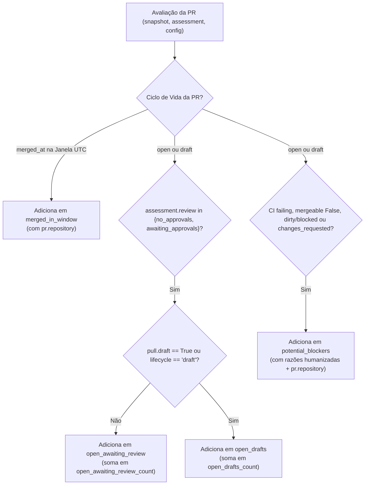

# Especificação Técnica — Incremento de Clareza da Visão Executiva

> **Documento de Especificação Técnica**  
> **Status:** Proposta para Aprovação  
> **Referência Base:** `docs/executive-report-view.md` (V1 consolidada na `main`)  
> **Data:** 05 de Novembro de 2026  

---

## 1. Contexto e Motivação

A Visão Executiva V1 (entregue na PR #20) estabeleceu com sucesso a geração sob demanda de resumos gerenciais a partir de snapshots imutáveis de Pull Requests, permitindo que operadores alternem entre a síntese executiva e as evidências técnicas originais.

Entretanto, uma simulação com cinco colaboradores e três repositórios (`portal-frontend`, `portal-backend` e `portal-integracoes`) identificou três ambiguidades de leitura para gerentes de projeto:
1. **Falta de identificação de repositório nos cards:** Em relatórios que consolidam múltiplos repositórios de um mesmo projeto, os cartões das PRs misturam itens de diferentes componentes sem sinalização visual da origem, exigindo inspeção manual de URLs para saber qual squad ou frente técnica atuar.
2. **Distorção no contador de PRs aguardando revisão por inclusão de rascunhos (*drafts*):** PRs em rascunho eram somadas no cartão métrico de *Aguardando revisão*, induzindo o gerente a cobrar revisores indevidamente por um trabalho que o autor ainda não finalizou.
3. **Linguagem técnica opaca em bloqueios:** Mensagens geradas diretamente de atributos crus da API do GitHub, como `Estado de mesclagem bloqueado observado: blocked.`, são confusas para gerentes não técnicos e não explicam o contexto operacional do bloqueio.

### 1.1 Objetivo
Aprimorar a clareza e a precisão das informações existentes na Visão Executiva, **sem ampliar a coleta de dados**, **sem criar novas tabelas ou migrações** e **sem recorrer a modelos não determinísticos de IA**.

---

## 2. Histórias de Usuário e Critérios de Aceitação

### HU 01: Identificação Explícita do Repositório nas Seções Executivas
**Como** gerente de projetos que acompanha repositórios múltiplos,  
**quero** visualizar a qual repositório cada Pull Request pertence diretamente no card e no texto copiado,  
**para** direcionar alinhamentos e cobranças à squad correta sem abrir links externos.

*Critérios de Aceitação:*
- **CA 1.1:** Em todas as seções executivas da interface (Integradas, Aguardando revisão, Em preparação e Possíveis bloqueios), cada card de PR deve exibir uma pílula ou rótulo acessível identificando o repositório (`pr.repository`).
- **CA 1.2:** O nome completo canônico do repositório (ex.: `empresa-alpha/portal-frontend`) deve ser diretamente acessível na interface e para tecnologias assistivas sem depender exclusivamente do atributo `title` ou de hover de ponteiro (sendo apresentado como texto visível ou com rótulo semântico acessível em tela), garantindo desambiguação inequívoca entre repositórios com o mesmo nome em contas ou organizações distintas.
- **CA 1.3:** Na função `render_executive_markdown()`, o texto copiado pelo botão *"Copiar para Gestão"* deve incluir o identificador do repositório em cada linha de PR (ex.: `- [#101 Título](url) · portal-frontend (autor: ...)`).
- **CA 1.4:** A identificação deve consumir estritamente o atributo `repository` já presente nos dados calculados, sem novas consultas ao banco de dados.

---

### HU 02: Separação de PRs em Rascunho (*Drafts*)
**Como** gerente de projetos,  
**quero** que PRs em rascunho não sejam somadas como prontas para revisão e sejam apresentadas em bloco diferenciado,  
**para** não cobrar revisores prematuramente por tarefas ainda em elaboração pelo autor.

*Critérios de Aceitação:*
- **CA 2.1:** O cartão métrico superior **"Aguardando revisão"** (`summary.open_awaiting_review_count`) deve contabilizar **estritamente PRs abertas prontas para revisão** (`is_draft is False` e ciclo de vida `open`).
- **CA 2.2:** PRs com marcação de rascunho (`draft is True` ou ciclo de vida `draft`) devem ser classificadas em uma lista segregada (`open_drafts`).
- **CA 2.3:** O resumo métrico (`summary`) deve expor a contagem complementar `open_drafts_count: len(open_drafts)`.
- **CA 2.4:** A Seção 2 da Visão Executiva deve apresentar primeiro as PRs prontas sob o título `2. Aguardando revisão (X)`. Se houver rascunhos observados, exibir logo abaixo o bloco `Em preparação / rascunho (Y)` com estilo visual atenuado e sem sinalização de urgência de revisão.
- **CA 2.5:** No Markdown gerado, as PRs em rascunho devem ser listadas em subseção explícita `### Em preparação / rascunho (Y)` ou rotuladas de forma clara, mantendo as evidências técnicas e a semântica de aprovações observadas.
- **CA 2.6:** O total geral de PRs observadas (`total_prs_observed`) deve permanecer inalterado, preservando a integridade da amostra coletada.

---

### HU 03: Linguagem Acessível e Precisa para Bloqueios Técnicos
**Como** gerente de projetos,  
**quero** que os motivos de possíveis bloqueios sejam descritos em linguagem compreensível e orientada à ação,  
**para** entender o que impede o avanço da esteira sem decifrar enums crus da API.

*Critérios de Aceitação:*
- **CA 3.1:** As razões de bloqueio geradas no backend devem adotar redação acessível em português, preservando o valor técnico original entre parênteses para auditoria:
  - **CI Falhando:** `"Verificações automatizadas (CI) com falha (status: failing)."`
  - **Conflito de Merge:** `"Conflito de mesclagem com a branch base (mergeable: false)."`
  - **Branch Suja:** `"Branch em conflito com a base impedindo mesclagem direta (mergeable_state: dirty)."`
  - **Revisão Rejeitada:** `"Revisão com alterações solicitadas pelo revisor (CHANGES_REQUESTED)."`
- **CA 3.2:** Para `mergeable_state: blocked`, o sistema **nunca** deve inferir ou atribuir uma causa específica não comprovada no payload (como branch protection, revisões pendentes ou restrições de permissão). A mensagem deve manter linguagem estritamente neutra e factual:  
  `"Mesclagem bloqueada ou restrita no GitHub (mergeable_state: blocked)."`
- **CA 3.3:** O título da seção permanece canonicamente como `3. Possíveis bloqueios técnicos`, preservando a semântica neutra de que se trata de indicadores observados na coleta, e não de impedimentos confirmados em reuniões de projeto.

---

## 3. Contratos de Dados e Retrocompatibilidade

### 3.1 Contrato da Resposta `executive` em `GET /api/reports/{id}/details`
O payload JSON gerado sob demanda em `build_executive_summary()` preserva todos os campos existentes e adiciona campos complementares não destrutivos:

```json
{
  "available": true,
  "report_complete": true,
  "summary": {
    "total_prs_observed": 15,
    "merged_in_window_count": 8,
    "open_awaiting_review_count": 2,
    "open_drafts_count": 1,
    "potential_blockers_count": 2
  },
  "window": {
    "since": "2026-10-26T00:00:00Z",
    "until": "2026-11-02T00:00:00Z"
  },
  "merged_in_window": [
    {
      "number": 101,
      "title": "feat(auth): login MFA",
      "url": "https://github.com/empresa-alpha/portal-frontend/pull/101",
      "repository": "empresa-alpha/portal-frontend",
      "merged_at": "2026-10-26T14:30:00Z",
      "author": "ana.silva",
      "merged_by": "bruno.costa",
      "base_branch": "main"
    }
  ],
  "open_awaiting_review": [
    {
      "number": 110,
      "title": "feat(relatorios): exportação CSV",
      "url": "https://github.com/empresa-alpha/portal-frontend/pull/110",
      "repository": "empresa-alpha/portal-frontend",
      "created_at": "2026-10-28T10:00:00Z",
      "author": "ana.silva",
      "is_draft": false,
      "approvals_observed": 0,
      "expected_approvals": 2,
      "review_state": "no_approvals"
    }
  ],
  "open_drafts": [
    {
      "number": 112,
      "title": "feat(pix): integração pagamentos",
      "url": "https://github.com/empresa-alpha/portal-integracoes/pull/112",
      "repository": "empresa-alpha/portal-integracoes",
      "created_at": "2026-10-29T14:00:00Z",
      "author": "elena.moraes",
      "is_draft": true,
      "approvals_observed": 0,
      "expected_approvals": 1,
      "review_state": "no_approvals"
    }
  ],
  "potential_blockers": [
    {
      "number": 114,
      "title": "feat(checkout): fluxo em uma página",
      "url": "https://github.com/empresa-alpha/portal-frontend/pull/114",
      "repository": "empresa-alpha/portal-frontend",
      "author": "ana.silva",
      "ci_state": "failing",
      "mergeable_state": "blocked",
      "review_state": "approved",
      "reasons": [
        "Verificações automatizadas (CI) com falha (status: failing).",
        "Mesclagem bloqueada ou restrita no GitHub (mergeable_state: blocked)."
      ]
    }
  ],
  "participants": [ ... ],
  "limitations": [ ... ],
  "markdown_text": "# Relatório Executivo Semanal\n..."
}
```

### 3.2 Formato do Markdown Executivo Copiado (`render_executive_markdown`)

```markdown
# Relatório Executivo Semanal

**Janela UTC:** `[2026-10-26T00:00:00Z, 2026-11-02T00:00:00Z)`

## 1. Integradas no período (1)
- [#101 feat(auth): login MFA](https://github.com/empresa-alpha/portal-frontend/pull/101) · empresa-alpha/portal-frontend (autor: @ana.silva, merge por: @bruno.costa em 2026-10-26T14:30:00Z)

## 2. Aguardando revisão (1)
- [#110 feat(relatorios): exportação CSV](https://github.com/empresa-alpha/portal-frontend/pull/110) · empresa-alpha/portal-frontend (autor: @ana.silva · aprovações observadas: 0/2)

### Em preparação / rascunho (1)
- [#112 feat(pix): integração pagamentos](https://github.com/empresa-alpha/portal-integracoes/pull/112) · empresa-alpha/portal-integracoes (autor: @elena.moraes · em preparação)

## 3. Possíveis bloqueios técnicos (1)
- [#114 feat(checkout): fluxo em uma página](https://github.com/empresa-alpha/portal-frontend/pull/114) · empresa-alpha/portal-frontend (autor: @ana.silva): Verificações automatizadas (CI) com falha (status: failing).; Mesclagem bloqueada ou restrita no GitHub (mergeable_state: blocked).

## 4. Participantes observados nas PRs coletadas (3)
- **@ana.silva**: author, reviewer (PRs: #101, #110, #114)
...
```

---

## 4. Regras de Classificação e Lógica de Negócio

No módulo `src/github_intelligence/report.py`, a função `build_executive_summary` atualizará o processamento da seguinte forma:



### Regras Estritas:
1. Uma PR em rascunho (`is_draft == True`) **nunca** é adicionada a `open_awaiting_review`.
2. Uma PR em rascunho pode constar em `potential_blockers` se possuir CI falho ou conflitos de merge, pois o autor pode se beneficiar do alerta de que seu rascunho já possui conflito com a branch base.
3. Nome canônico do repositório: o sistema exibe o nome canônico do repositório de forma visível e acessível (`pr.repository`, ex.: `empresa-alpha/portal-frontend`), tanto na interface web quanto no Markdown, sem depender de atributos ocultos ou hovers de ponteiro, eliminando qualquer ambiguidade entre múltiplos repositórios.

---

## 5. Estratégia de Interface e Apresentação (Frontend)

No módulo `src/github_intelligence/dashboard_assets/modules/history.js`:
1. **Pílula de Repositório (`exec-repo-pill`):**
   - Criada via `el('span', pr.repository, 'code-pill exec-repo-pill')`, exibindo diretamente o nome canônico do repositório de forma visível e legível por leitores de tela e dispositivos móveis.
   - Inserida junto aos metadados do card de cada PR.
2. **Subseção de Rascunhos na Seção 2:**
   - Renderizada após as PRs de `open_awaiting_review`.
   - Se `open_drafts` contiver itens, cria cabeçalho atenuado `Em preparação / rascunho (N)` e renderiza cards com estilo discreto.
3. **Cartões Métricos:**
   - O cartão `Aguardando revisão` lê `executive.summary.open_awaiting_review_count`.
   - Não sofre influência das PRs em rascunho.
4. **Segurança e XSS:**
   - Mantém o padrão estrito de construção segura de DOM sem `innerHTML`, manipulando nós via `.textContent` e `.append()`.

---

## 6. Matriz de Testes e Não-Regressão

| Caso de Teste | Local do Teste | Comportamento Verificado |
| :--- | :--- | :--- |
| **T1: Repositório em cada card executivo** | `tests/unit/test_report.py` | Garante que cada item de `merged_in_window`, `open_awaiting_review`, `open_drafts` e `potential_blockers` contenha a chave `repository`, e que `render_executive_markdown` a inclua no texto gerado com nome canônico. |
| **T2: Segregação estrita de PRs em rascunho** | `tests/unit/test_report.py` | Uma PR com `draft=True` e `0/2 aprovações` deve constar em `open_drafts` e **não** em `open_awaiting_review`. `open_awaiting_review_count` deve ser 0 e `open_drafts_count` deve ser 1. |
| **T3: Contagem de PRs abertas sem inflação** | `tests/unit/test_report.py` | Cenário com 2 PRs abertas prontas e 1 PR em rascunho: `open_awaiting_review_count == 2`, `open_drafts_count == 1`, `total_prs_observed == 3`. |
| **T4: Humanização de razões de bloqueio** | `tests/unit/test_report.py` | Valida que falha de CI gera `"Verificações automatizadas (CI) com falha (status: failing)."` e `mergeable_state="blocked"` gera `"Mesclagem bloqueada ou restrita no GitHub (mergeable_state: blocked)."` sem inventar causas. |
| **T5: Retrocompatibilidade de Endpoint** | `tests/unit/test_dashboard.py` | Valida que `GET /api/reports/{id}/details` retorna a estrutura executiva preservando `content` intacto e sem quebras em clientes antigos. |
| **T6: Renderização do Drawer e Abas** | `tests/js/analyses_navigation.test.cjs` | Valida que a interface JavaScript renderiza os cartões métricos, a separação de rascunhos e a alternância entre abas sem erros no console. |

---

## 7. Limites do Escopo (Non-Goals)

Para assegurar simplicidade e evitar dispersão, os seguintes itens estão **estritamente fora do escopo**:
- **Aging e SLA de revisão:** Cálculo de dias em aberto ou contadores de horas não serão introduzidos neste incremento.
- **Integração com Jira ou Issues do GitHub:** Nenhuma dependência externa ou parsing de regex de tickets corporativos.
- **Inteligência Artificial Generativa:** Todo o texto gerado permanece 100% determinístico e baseado em regras determinísticas.
- **Novas tabelas ou migrações de banco:** Nenhuma alteração no Supabase ou PostgreSQL.
- **Rankings ou pontuação de colaboradores:** Continua vedada qualquer forma de comparação individual de produtividade.
- **Mudança na coleta de dados da API do GitHub:** O pipeline de sincronização e os modelos `PullRequestSnapshot` permanecem intocados.
