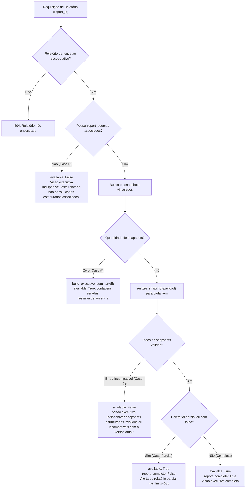

# Especificação Técnica — Visão Executiva do GitHub Intelligence

> **Documento de Consolidação Técnica**  
> **Status:** Aprovado e Implementado  
> **Branch de Referência:** `feature/executive-report-view`  
> **Commits:** `0302e61` (implementação vertical) e `d594c97` (correções e resiliência pós-code review)  
> **Data de Consolidação:** 05 de Novembro de 2026  

---

## 1. Problema de Negócio e Público-Alvo

### 1.1 Público-Alvo
Gerentes de Projetos, Coordenadores Técnicos e Líderes de Engenharia que acompanham o ciclo de desenvolvimento de software em repositórios corporativos.

### 1.2 Problema de Negócio
O GitHub Intelligence operava primariamente gerando relatórios de evidências em Markdown bruto (`report.content`), expostos no dashboard em blocos monoespaçados (`<pre>`). Embora essa abordagem seja indispensável para auditoria técnica detalhada, operadores e gestores de projetos enfrentavam as seguintes barreiras:
1. **Dificuldade de Leitura Executiva:** Identificar o volume real de entregas semanais exigia varrer manualmente dezenas ou centenas de linhas de logs, SHAs de commits e metadados de branches.
2. **Ambiguidade Temporal:** Confusão frequente entre eventos pontuais ocorridos durante a semana (ex.: merges concluídos) e estados estáticos observados no instante da coleta (ex.: PRs abertas ou em rascunho).
3. **Falta de Destaque para Bloqueios:** PRs travadas por falha de CI, conflitos de merge ou reprovações de revisão ficavam diluídas no texto bruto.
4. **Comunicação Ineficiente:** Inexistência de um formato limpo e sintetizado para cópia rápida em rituais de alinhamento executivo e status reports.

### 1.3 Solução Adotada
A **Visão Executiva** introduz uma camada estruturada de síntese gerencial calculada sob demanda a partir de snapshots de Pull Requests já persistidos, apresentada lado a lado com as **Evidências Técnicas** originais através de abas comutáveis no dashboard, sem alterar dados históricos, sem criar novas tabelas e sem recorrer a modelos não determinísticos de IA.

---

## 2. Histórias de Usuário e Critérios de Aceitação

### HU 01: Visualização Sintetizada de Entregas da Janela
**Como** gerente de projetos,  
**quero** visualizar de forma imediata quais Pull Requests foram efetivamente integradas na janela semanal selecionada,  
**para** acompanhar o progresso das entregas sem interpretar diffs ou SHAs de commits.

*Critérios de Aceitação:*
- **CA 1.1:** O sistema deve contabilizar e listar apenas PRs cujo evento `merged_at` esteja contido no intervalo fechado à esquerda e aberto à direita `[since, until)` em UTC.
- **CA 1.2:** Cada item deve exibir o número da PR, título sanitizado, link seguro para o GitHub, autor, responsável pelo merge, data/hora do merge e branch de destino.
- **CA 1.3:** Na ausência de PRs integradas na janela, exibir a mensagem explícita: `Nenhuma PR integrada observada dentro desta janela temporal.`.

### HU 02: Acompanhamento de PRs Aguardando Revisão
**Como** gerente de projetos,  
**quero** saber quais PRs ativas estão pendentes de aprovação e qual é o progresso observado dessas revisões,  
**para** priorizar cobranças de code review com o time.

*Critérios de Aceitação:*
- **CA 2.1:** Devem ser incluídas PRs com ciclo de vida `open` ou `draft` cujo estado de revisão avaliado seja `no_approvals` ou `awaiting_approvals`.
- **CA 2.2:** Cada item deve explicitar o número de aprovações observadas versus a expectativa local configurada no repositório (ex.: `1/2 (expectativa local)`).
- **CA 2.3:** PRs em rascunho devem conter a marcação explícita `[Rascunho]`.
- **CA 2.4:** Na ausência de PRs pendentes, exibir: `Nenhuma PR aberta aguardando aprovações.`.

### HU 03: Alerta Antecipado de Bloqueios Técnicos
**Como** gerente de projetos,  
**quero** ser alertado sobre PRs ativas que possuam impedimentos técnicos críticos,  
**para** acionar imediatamente os responsáveis pelo desbloqueio.

*Critérios de Aceitação:*
- **CA 3.1:** Devem ser sinalizadas PRs ativas (`open` ou `draft`) que apresentem pelo menos uma das seguintes condições:
  - Checks ou status de CI falhando no head commit (`assessment.ci == "failing"`).
  - Conflito de mesclagem detectado (`pull.mergeable == False` ou `pull.mergeable_state in {"blocked", "dirty"}`).
  - Revisão rejeitada com solicitação de alterações (`assessment.review == "changes_requested"`).
- **CA 3.2:** A lista deve descrever em linguagem clara os motivos específicos do bloqueio identificados.
- **CA 3.3:** Na ausência de bloqueios, exibir: `Nenhum bloqueio técnico crítico observado nas PRs ativas.`.

### HU 04: Mapeamento Neutro de Participantes
**Como** coordenador de equipe,  
**quero** visualizar os colaboradores observados nas PRs coletadas e seus respectivos papéis,  
**para** entender a composição da atuação sem induzir comparações ou ranqueamentos de produtividade.

*Critérios de Aceitação:*
- **CA 4.1:** A lista de participantes deve consolidar logins do GitHub observados estritamente nos papéis: autor (`author`), mergeador (`merged_by`), revisor (`reviewer`) e autor/committer de commit (`committer`).
- **CA 4.2:** A ordenação deve ser estritamente alfabética pelo login (`login.casefold()`), sem qualquer ordenação por volume de commits, linhas de código ou quantidade de PRs.
- **CA 4.3:** A seção deve ser intitulada canonicamente como `4. Participantes observados nas PRs coletadas`.
- **CA 4.4:** Na ausência de participantes, exibir: `Nenhum participante observado nas PRs coletadas.`.

### HU 05: Alternância Acessível entre Visão Executiva e Evidências Técnicas
**Como** operador técnico ou gestor,  
**quero** alternar instantaneamente entre a síntese executiva e o relatório técnico completo no drawer e na página dedicada,  
**para** validar qualquer número apresentado contra o relatório bruto original.

*Critérios de Aceitação:*
- **CA 5.1:** A interface deve fornecer duas abas semânticas: `Visão Executiva` e `Evidências Técnicas` (`role="tab"`, `aria-selected`).
- **CA 5.2:** O relatório técnico original (`report.content`) deve permanecer 100% íntegro, servido em bloco monoespaçado (`<pre>`).
- **CA 5.3:** A alternância deve ocorrer no cliente via classes CSS/hidden, sem requisições adicionais de rede.
- **CA 5.4:** Se a visão executiva estiver disponível, o dashboard abre por padrão na aba executiva; se indisponível, foca na aba técnica e exibe aviso amigável na aba executiva.

### HU 06: Cópia Formatada para Alinhamentos Gerenciais
**Como** gerente de projetos,  
**quero** copiar a síntese executiva diretamente em formato Markdown para a área de transferência,  
**para** colar em e-mails, atas de reunião e ferramentas de comunicação corporativa.

*Critérios de Aceitação:*
- **CA 6.1:** Deve existir um botão dedicado `Copiar para Gestão` habilitado apenas quando a visão executiva for válida.
- **CA 6.2:** O texto copiado deve ser gerado por `render_executive_markdown()`, contendo título, janela UTC, seções numeradas e ressalvas obrigatórias.
- **CA 6.3:** Deve fornecer feedback visual temporário (`Copiado!`) por 2 segundos.
- **CA 6.4:** O botão `Copiar Markdown` original das evidências técnicas deve permanecer funcional e independente.

---

## 3. Visão Executiva versus Evidências Técnicas

| Dimensão | Visão Executiva | Evidências Técnicas |
| :--- | :--- | :--- |
| **Finalidade Primária** | Comunicação de alto nível, gestão de bloqueios e alinhamento de escopo semanal. | Auditoria determinística, inspeção de SHAs, rastreabilidade forense e debugging técnico. |
| **Público-Alvo** | Gerentes de projeto, scrum masters, diretores e operadores de negócio. | Desenvolvedores de software, arquitetos e operadores locais do sistema. |
| **Formato Visual** | Grid de 4 cartões métricos, cards de PRs com links HTML, badges de rascunho e listas estruturadas. | Bloco único de texto cru monoespaçado (`<pre>`) formatado em Markdown do gerador. |
| **Tratamento Temporal** | Separação explícita entre **eventos da janela** (seção 1) e **estados atuais** (seções 2 e 3). | Eventos e estados apresentados no corpo do texto técnico com alertas textuais. |
| **Métricas Apresentadas** | 4 contadores objetivos: Merges na janela, Aguardando revisão, Bloqueios e Total de PRs. | Nenhuma métrica sintética isolada; dados contextuais por repositório. |
| **Persistência no Banco** | Gerada **sob demanda** a partir dos snapshots de PR (`pr_snapshots`) associados ao relatório. | Armazenada estaticamente na coluna `reports.content` no momento da coleta. |

---

## 4. Arquitetura de Geração sob Demanda a Partir de Snapshots

A geração da Visão Executiva foi concebida sob o princípio de **cálculo sob demanda determinístico**:
1. **Ausência de Mutação de Dados:** A visualização de relatórios históricos não grava registros, não aciona migrações de schema e não invoca APIs externas do GitHub.
2. **Reaproveitamento de Snapshots Estruturados:** Ao receber uma solicitação de detalhes de relatório (`GET /api/reports/{id}/details`), o método `DashboardStore.get_report_executive(report_id)` consulta os snapshots imutáveis salvos em `pr_snapshots` vinculados ao relatório.
3. **Reconstituição Validada:** Os payloads JSONB são desserializados através da função canônica `restore_snapshot(payload)`, que aplica validações Pydantic contra os modelos `PullRequestSnapshot`.
4. **Avaliação Determinística:** Os objetos restaurados são processados por `evaluate(snapshot, config)` e consolidados pela função pura `build_executive_summary(snapshots, window, ...)`.
5. **Composição da Resposta:** O payload JSON retornado pela API HTTP adiciona o campo `executive` ao dicionário de resposta, preservando o campo `content` inalterado.

---

## 5. Associação Estrutural entre Tabelas

A consulta relacional implementada em `DashboardStore.get_report_executive` garante integridade estrita entre o relatório, suas fontes de sincronização e os snapshots de PR:

```sql
SELECT DISTINCT snap.id, snap.pr_number, snap.payload
FROM github_intelligence.report_sources rs
JOIN github_intelligence.sync_runs sr
  ON (sr.client_id, sr.project_id, sr.id) = (rs.client_id, rs.project_id, rs.sync_run_id)
JOIN github_intelligence.pr_snapshots snap
  ON (snap.client_id, snap.project_id, snap.sync_run_id) = (sr.client_id, sr.project_id, sr.id)
  AND (rs.snapshot_id IS NULL OR rs.snapshot_id = snap.id)
WHERE rs.client_id = %s AND rs.project_id = %s AND rs.report_id = %s
ORDER BY snap.pr_number ASC;
```

### Regras de Vínculo:
- **`rs.snapshot_id IS NULL`:** Trata coletas onde a execução de sincronização vinculou todas as PRs daquele `sync_run` ao relatório (comportamento padrão quando não há granularidade por PR individual).
- **`rs.snapshot_id = snap.id`:** Trata vínculos granulares específicos por snapshot.
- **Deduplicação:** Uso explícito de `SELECT DISTINCT` para evitar duplicação em casos de junção múltipla de fontes.
- **Configuração de Repositórios:** Configurações operacionais (`expected_approvals`, `staging_branch`) são recuperadas via `JOIN github_intelligence.repositories` a partir do `sync_run`.

---

## 6. Isolamento Multitenant e Segurança de Dados (RLS)

O GitHub Intelligence opera sob modelo estrito de isolamento por cliente e projeto:
1. **Transação de Escopo com RLS:** Todas as consultas no backend são envolvidas pelo context manager `project_transaction(connection, self._scope)`, que define as variáveis de sessão no PostgreSQL:
   ```sql
   SET LOCAL "app.current_client_id" = '<UUID>';
   SET LOCAL "app.current_project_id" = '<UUID>';
   ```
2. **Predicados Explícitos em Todas as Tabelas:** Toda cláusula `WHERE` e todo `JOIN` entre tabelas do schema `github_intelligence` valida os pares `(client_id, project_id)`.
3. **Validação de Ativação:** O relatório só é localizado se os registros correspondentes em `clients` e `projects` estiverem com `status = 'active'`.
4. **Isolamento Comprovado:** Tentativas de consultar um `report_id` pertencente a outro cliente ou projeto resultam em erro HTTP `404 Not Found` ou `available: false` com motivo de escopo, sem vazamento de metadados.

---

## 7. Separação Temporal Estrita: Janela UTC vs. Estados Observados

A especificação impõe uma fronteira matemática rígida entre duas dimensões temporais:

### 7.1 Janela Temporal UTC Half-Open `[since, until)`
- Uma PR é considerada **Integrada no Período** se, e somente se:
  $$\text{window.since} \le \text{merged\_at} < \text{window.until}$$
- PRs integradas fora deste intervalo exato (mesmo por segundos) **não** entram na Seção 1.

### 7.2 Estados Observados na Coleta
- As seções **Aguardando revisão** e **Possíveis bloqueios** não representam eventos passados da semana; representam o **estado da PR no momento da execução da coleta** (`observed_at`).
- Uma PR aberta que foi inspecionada é classificada com base em seu estado atual, mesmo que tenha sido criada antes da janela semanal.

---

## 8. Semântica de Participantes e Neutralidade Analítica

### 8.1 Diretrizes Canônicas
1. **Nomenclatura Obrigatória:** A Seção 4 deve ser nomeada estritamente como `Participantes observados nas PRs coletadas`.
2. **Sem Métricas de Produtividade:** É expressamente proibido calcular "linhas de código por autor", "tempo médio de entrega individual", "ranking de desenvolvedores" ou qualquer pontuação de desempenho.
3. **Papéis Neutros:** A participação limita-se aos papéis observáveis: `author`, `merged_by`, `reviewer` e `committer`.
4. **Identidade via Login do GitHub:** Apenas logins confirmados do GitHub são registrados. E-mails e assinaturas brutas do Git não são mapeados heuristicamente.
5. **Ressalva Explícita:** O texto gerado e a interface devem sempre exibir a ressalva de que a identificação reflete apenas a amostra de PRs coletadas, sem comprovação de atividade integral no período.

---

## 9. Tratamento de Casos de Borda e Resiliência Operacional

O sistema trata os quatro cenários operacionais de forma determinística e segura:



### 9.1 Caso A — Coleta Completa com Zero PRs
- Ocorre quando a sincronização de um repositório é concluída com sucesso mas nenhuma PR atende aos critérios de coleta.
- **Comportamento:** Retorna `available: true`, `report_complete: true`, contadores zerados (`0`), listas vazias e limitação declarando: `Amostra restrita às PRs observadas; não comprova ausência total de atividade no GitHub.`.

### 9.2 Caso B — Relatório Legado sem Fontes Estruturadas
- Ocorre em relatórios antigos persistidos antes da implementação de `report_sources` ou em relatórios de migração.
- **Comportamento:** Retorna `available: false`, com `reason: "Visão executiva indisponível: este relatório não possui dados estruturados associados."`. O relatório técnico (`content`) permanece 100% acessível na aba técnica.

### 9.3 Caso C — Snapshots Inválidos ou com Schema Incompatível
- Ocorre em caso de corrupção de payload JSONB ou evolução de contratos do Pydantic que quebre a desserialização.
- **Comportamento:** O erro de parse (`ValueError`, `TypeError`, `KeyError`, `ValidationError`) é capturado defensivamente. Retorna `available: false`, com `reason: "Visão executiva indisponível: snapshots estruturados inválidos ou incompatíveis com a versão atual."`. Não vaza detalhes de SQL, dados de payload ou stacktraces para o cliente. Não descarta silenciosamente snapshots corrompidos para não apresentar dados parciais falsos.

### 9.4 Caso Parcial — Coletas com Limitações vs. Falhas sem Relatório
- **Diferenciação Arquitetural:**
  - **Falha de Execução sem Relatório:** Uma tentativa de sincronização que falhe antes da persistência (ex.: erro de autenticação, timeout de rede ou exceção durante o pipeline) marca `sync_runs.status = 'failed'` e sofre rollback transacional, **não gerando nenhum registro na tabela `reports`** nem em `report_sources`.
  - **Coleta Parcial com Relatório:** Ocorre quando a coleta é concluída mas identifica limitações de cobertura, fontes indisponíveis ou snapshots inconsistentes. Nesse caso, a transação persiste o relatório com `reports.complete = False` e `sync_runs.status = 'partial'`.
- **Tratamento em `DashboardStore`:** A função `get_report_executive` avalia `is_partial = not bool(report_row["complete"])` e verifica defensivamente se alguma fonte vinculada possui `sync_status in {'partial', 'failed'}`.
- **Comportamento da Visão Executiva:** Retorna `available: true`, mas define `report_complete: false`. Exibe aviso em destaque no início do resumo e insere a limitação prioritária: `Relatório parcial: há fontes indisponíveis ou snapshots inconsistentes no período.`.

---

## 10. Preservação Integral do Relatório Técnico

Em conformidade estrita com o princípio de conservação de evidências:
- O atributo `content` retornado por `GET /api/reports/{id}/details` é o texto Markdown exato armazenado em banco, sem sofrer nenhuma alteração, truncamento ou reprocessamento.
- Na interface web, o elemento `#drawer-content` (no drawer) e `#report-content` (na página dedicada) renderiza o texto puro em `<pre>` mantendo a formatação e espaçamento originais.
- A falha ou ausência da visão executiva não impacta a leitura do relatório técnico.

---

## 11. Segurança de Apresentação e Prevenção de XSS

1. **Construção de DOM sem `innerHTML`:**
   Todo o frontend da Visão Executiva em `history.js` utiliza estritamente `document.createElement`, manipulando nós de texto via `.textContent` e filhos via `.append()` / `.replaceChildren()`.
2. **Sanitização de URLs no Backend:**
   A função `_url(value)` em `report.py` aplica regras estritas:
   - Esquema obrigatório: `https`.
   - Host restrito a `github.com` ou `api.github.com`.
   - Rejeição de URLs com portas, credenciais embutidas (`user:pass@`), caracteres de controle ou barras invertidas.
3. **Isolamento de Links Externos:**
   Todos os links gerados para Pull Requests possuem os atributos `target="_blank"` e `rel="noopener noreferrer"`.
4. **Cópia Segura para Área de Transferência:**
   A funcionalidade de cópia utiliza a API nativa `navigator.clipboard.writeText`, encapsulada em blocos `try/catch` para capturar rejeições de permissão do navegador sem provocar exceções não tratadas no console.

---

## 12. Limitações Conhecidas e Fronteiras de Interpretação

O sistema comunica explicitamente cinco limitações fundamentais:
1. **Merge não Comprova Deploy:** A integração de uma PR na branch base indica apenas mesclagem de código; não prova que o código foi compilado, distribuído ou publicado em ambientes produtivos.
2. **Merge não Comprova Validação Funcional:** A mesclagem não atesta conformidade com regras de negócio ou ausência de defeitos funcionais.
3. **Expectativa Local de Revisão:** O limiar de aprovações (ex.: `2`) é uma configuração operacional local do GitHub Intelligence, não uma regra confirmada de Branch Protection ou CODEOWNERS do GitHub.
4. **Amostra de Coleta Restrita:** Apenas Pull Requests capturadas na coleta são avaliadas; a ausência de registros em uma categoria não prova ausência de atividade na organização.
5. **Horários de Eventos vs. Horários de Commits:** Commits registrados em uma PR refletem a data informada pelo committer local, não comprovando o momento exato do `push` para o servidor do GitHub.

---

## 13. Requisitos Fora de Escopo (Non-Goals)

Os seguintes itens foram explicitamente excluídos do escopo deste incremento:
- **Inteligência Artificial Generativa:** Não há geração de texto por LLM, resumos neurais ou inferências probabilísticas; toda a síntese é puramente algorítmica e determinística.
- **Cadastro e Gestão de Colaboradores:** Não há módulo de vinculação de e-mails, gerenciamento de equipes ou cadastro manual de membros.
- **Novas Migrações de Banco:** Não foram criadas tabelas, colunas, views ou triggers adicionais no Supabase / PostgreSQL.
- **Sincronização em Segundo Plano ou Webhooks:** A coleta permanece sob demanda disparada manualmente pelo operador.
- **Exportação de Arquivos:** Geração de arquivos PDF, envio de e-mails via SMTP/Resend e integração com Slack permanecem fora de escopo.
- **API Externa em Nuvem:** O sistema permanece servido estritamente em loopback local (`127.0.0.1:8765`).

---

## 14. Matriz de Rastreabilidade

A matriz a seguir mapeia cada requisito especificado às suas funções no código, aos testes automatizados que comprovam o comportamento, à evidência de execução e ao status final de consolidação.

> **Nota sobre Evidências de Teste:** Os testes unitários e de integração utilizam fixtures sintéticas controladas e bancos PostgreSQL descartáveis locais (harness isolado em loopback), validando estritamente a lógica de negócio, o isolamento de escopo e os contratos de dados. Eles **não** constituem nem pretendem comprovar consultas reais à API remota do GitHub.

### Legenda de Status:
- ✅ **Aprovado e Implementado:** Requisito acordado com cobertura completa de testes unitários/integração e validação funcional.
- ⚠️ **Aprovado sem Comprovação Suficiente:** Requisito acordado onde os testes cobrem apenas cenários parciais. *(Nenhum item nesta condição).*
- ❌ **Comportamento Implementado não Correspondente a Requisito Aprovado:** Código presente sem respaldo nos requisitos acordados. *(Nenhum item nesta condição).*

| Requisito / Critério | Arquivo / Função | Teste Automatizado | Evidência de Execução | Status |
| :--- | :--- | :--- | :--- | :---: |
| **REQ-01: Filtro de Janela UTC Half-Open `[since, until)`** (CA 1.1, CA 1.2) | `report.py`:<br>`build_executive_summary` | `tests/unit/test_report.py`:<br>`test_executive_summary_half_open_utc_window_boundaries` | Pytest Unit: Fixtures sintéticas comprovam inclusão de merge dentro de `[since, until)` e exclusão nos limites exatos. | ✅ Aprovado e Implementado |
| **REQ-02: PRs Aguardando Revisão e Expectativa Local** (CA 2.1, CA 2.2, CA 2.3) | `report.py`:<br>`build_executive_summary` | `tests/unit/test_report.py`:<br>`test_executive_summary_open_awaiting_review_and_blockers` | Pytest Unit: Validação de PR aberta com contagem de aprovações observadas versus expectativa local e etiqueta `[Rascunho]`. | ✅ Aprovado e Implementado |
| **REQ-03: Detecção de Bloqueios Técnicos Críticos** (CA 3.1, CA 3.2) | `report.py`:<br>`build_executive_summary` | `tests/unit/test_report.py`:<br>`test_executive_summary_open_awaiting_review_and_blockers` | Pytest Unit: Classificação de bloqueios por CI falhando, conflitos de mesclagem (`dirty`/`blocked`) e solicitação de alterações. | ✅ Aprovado e Implementado |
| **REQ-04: Semântica e Neutralidade de Participantes** (CA 4.1, CA 4.2, CA 4.3) | `report.py`:<br>`build_executive_summary`<br>`render_executive_markdown` | `tests/unit/test_report.py`:<br>`test_executive_summary_participants_without_ranking`<br>`test_executive_summary_participants_semantics_in_markdown` | Pytest Unit: Título canônico `Participantes observados nas PRs coletadas`, ordenação alfabética e papéis neutros sem rankings. | ✅ Aprovado e Implementado |
| **REQ-05: Coleta Válida com Zero PRs (Caso A)** (CA 1.3, CA 2.4, CA 3.3, CA 4.4) | `report.py`:<br>`build_executive_summary`<br>`dashboard_data.py`:<br>`get_report_executive` | `tests/unit/test_report.py`:<br>`test_executive_summary_empty_snapshots_has_zeroed_counts_and_safe_caveat`<br>`tests/integration/test_dashboard_data.py`:<br>`test_get_report_executive_case_a_complete_zero_prs` | Pytest Unit & Integration: Retorna `available: true`, contadores em 0, mensagens de lista vazia e ressalva de não ausência total. | ✅ Aprovado e Implementado |
| **REQ-06: Relatório Legado sem Fontes (Caso B)** (Seção 9.2) | `dashboard_data.py`:<br>`get_report_executive` | `tests/integration/test_dashboard_data.py`:<br>`test_get_report_executive_case_b_legacy_report_without_sources` | Pytest Integration (PostgreSQL local): Retorna `available: false` com motivo legível; `content` técnico permanece acessível. | ✅ Aprovado e Implementado |
| **REQ-07: Snapshots Inválidos ou Incompatíveis (Caso C)** (Seção 9.3) | `dashboard_data.py`:<br>`get_report_executive` | `tests/integration/test_dashboard_data.py`:<br>`test_get_report_executive_case_c_invalid_and_incompatible_snapshots`<br>`test_get_report_executive_does_not_silently_discard_invalid_snapshot` | Pytest Integration (PostgreSQL local): Rejeita desserialização inválida com mensagem segura, sem vazar SQL e sem descarte silencioso. | ✅ Aprovado e Implementado |
| **REQ-08: Coletas Parciais com Limitações** (Seção 9.4) | `report.py`:<br>`build_executive_summary`<br>`dashboard_data.py`:<br>`get_report_executive` | `tests/unit/test_report.py`:<br>`test_executive_summary_partial_limitations_and_sanitization`<br>`tests/integration/test_dashboard_data.py`:<br>`test_get_report_executive_case_c_partial_collection_limitations` | Pytest Unit & Integration: Marca `report_complete: false` e adiciona alerta prioritário de relatório parcial. | ✅ Aprovado e Implementado |
| **REQ-09: Isolamento de Escopo Multitenant e RLS** (Seção 6) | `dashboard_data.py`:<br>`get_report_executive` | `tests/integration/test_dashboard_data.py`:<br>`test_get_report_executive_with_persisted_snapshots_and_project_isolation` | Pytest Integration (PostgreSQL local): Cliente/projeto B não visualiza relatório do projeto A (`available: false`). | ✅ Aprovado e Implementado |
| **REQ-10: Contrato do Endpoint e Preservação de Conteúdo** (CA 5.2, Seção 10) | `dashboard.py`:<br>`GET /api/reports/{id}/details` | `tests/unit/test_dashboard.py`:<br>`test_report_details_route_attaches_executive_payload`<br>`test_read_only_history_summary_and_details_routes_preserve_original_report` | Pytest Unit: Endpoint HTTP loopback anexa payload `executive` e preserva string `content` sem alteração. | ✅ Aprovado e Implementado |
| **REQ-11: Alternância de Abas e Aviso de Indisponibilidade** (CA 5.1, CA 5.3, CA 5.4) | `modules/history.js`:<br>`switchViewTab`<br>`renderExecutiveView` | `tests/js/analyses_navigation.test.cjs`:<br>`drawer renders executive view and allows switching...`<br>`drawer displays unavailable notice...` | Node.js Test Runner: DOM emulado valida transição de classes, atributos ARIA e renderização de banner para legado. | ✅ Aprovado e Implementado |
| **REQ-12: Cópia Formatada para Gestão** (CA 6.1, CA 6.2, CA 6.3, CA 6.4) | `modules/history.js`:<br>Event listener `#drawer-copy-exec-btn` | Smoke Test Chrome Headless CDP | CDP Protocol: `navigator.clipboard.writeText` invocado com markdown executivo formatado; label alterado para 'Copiado!'. | ✅ Aprovado e Implementado |
| **REQ-13: Prevenção de XSS e Sanitização de URLs** (Seção 11) | `report.py`:<br>`_text`, `_url`<br>`modules/history.js` | `tests/unit/test_report.py`:<br>`test_executive_summary_partial_limitations_and_sanitization`<br>Smoke Test Chrome Headless CDP | Pytest & CDP: URLs perigosas (`javascript:`, portas, credenciais) bloqueadas; nós DOM criados via `createElement`. | ✅ Aprovado e Implementado |
| **REQ-14: Cache-Busting no HTML (ADR 0003)** | `index.html`:<br>`link`, `script` com `?v=16` | `tests/unit/test_dashboard.py`:<br>`test_modular_frontend_assets_served_with_strict_allowlist_and_security_headers` | Pytest Unit: Servidor local aceita `?v=16` com status 200 e headers estritos de segurança, rejeitando query params espúrios. | ✅ Aprovado e Implementado |

---

## 15. Análise de Divergências Reais entre Código e Especificação

Após inspeção aprofundada linha a linha entre a especificação formulada e o código existente na branch `feature/executive-report-view`, **não foram identificadas divergências funcionais ou contratuais**. 

Destacam-se três decisões de implementação que refinam a robustez do sistema:
1. **Injeção do Campo `executive` no Nível de Aplicação:**  
   Em `dashboard.py`, a injeção do dicionário `executive` é feita em Python chamando `app.store.get_report_executive(report_id)`, e não através de uma consulta JSON embutida no CTE SQL de `get_report_details`.  
   *Justificativa:* Mantém o CTE SQL focado na recuperação leve de dados de histórico e delega a computação determinística para o interpretador Python, facilitando testes e isolamento de falhas.
2. **Fallback Gracioso para a Aba Técnica:**  
   Caso a visão executiva esteja indisponível (`available: false`), o código do frontend (`history.js`) seleciona ativamente a aba técnica (`Evidências Técnicas`), evitando que o operador visualize uma tela vazia por engano.
3. **Não Desserialização Parcial de Snapshots:**  
   Caso um único snapshot de uma coleção esteja corrompido ou incompatível, o sistema rejeita a geração completa da visão executiva em vez de descartar silenciosamente o registro defeituoso e apresentar números subestimados.

---

## 16. Pendências que Precisam de Decisão Humana

As seguintes questões não impedem a publicação da Pull Request atual, mas devem ser avaliadas pela equipe de produto/engenharia para iterações futuras:

1. **Estratégia de Longo Prazo para Relatórios Legados:**  
   Relatórios gerados em versões anteriores da ferramenta não possuem `report_sources` associados e exibem a mensagem amigável de indisponibilidade. Deve-se avaliar se haverá um script operacional de reconciliação histórica ou se tais relatórios permanecerão permanentemente no modo de evidências técnicas apenas.
2. **Relatórios Multi-Repositório no Mesmo Projeto:**  
   A implementação atual agrega todas as PRs das fontes vinculadas ao relatório. Para projetos que monitoram múltiplos repositórios no mesmo relatório, os cartões de métricas somam o total consolidado. Deve-se avaliar futuramente se gestores desejarão um filtro de repositório interno dentro da própria aba executiva.
3. **Persistência Opcional do Markdown Executivo no Banco:**  
   Atualmente, o Markdown executivo é renderizado sob demanda em memória. Caso haja necessidade futura de auditoria legal de relatórios executivos emitidos ou envio assíncrono por webhook/e-mail sem reavaliação de código, poderá ser avaliada a persistência do texto executivo como uma coluna auxiliar na tabela `reports`.
